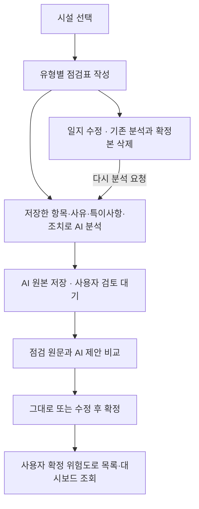

# WaterAPI | 시설 점검과 AI 분석

상하수도 시설과 점검일지를 관리하는 개인 웹 프로젝트입니다. 펌프·배관·밸브·수질 센서별로 현장에서 관찰한 항목을 기록합니다. 사용자는 AI 제안을 점검 원문과 비교한 뒤 그대로 확정하거나 수정해 확정할 수 있습니다.

**Java 17 · Spring Boot 4.1 · Spring Data JPA · Thymeleaf · MySQL · Flyway · OpenAI · Docker · AWS**

## 전체 흐름

## 문제와 해결, 확인 결과

| 문제 | 해결 | 확인 결과 |
| --- | --- | --- |
| 검토 중 값을 바꾸면 AI가 처음 제안한 내용을 잃을 수 있습니다. | AI 원본을 보존하고 사용자 확정본과 확정 시각을 별도로 저장합니다. 목록은 대기일 때 AI 제안, 확정 후에는 사용자 위험도로 표시·필터링합니다. 대시보드의 위험도 집계에는 확정본만 포함합니다. | PR #3 병합 전, 사용자가 집 PC의 `feature/analysis-review`에서 그대로 확정과 위험도·권장 조치 변경 후 확정을 직접 실행하고 화면을 공유했습니다. |
| 같은 분석에 확정 요청이 두 번 들어올 수 있습니다. | 점검일지와 분석 ID가 맞고 검토 대기인 경우에만 확정합니다. | MySQL에 동시에 보낸 두 요청 중 하나만 성공했습니다. |
| 일지를 수정하면 이전 분석과 확정본의 근거가 달라집니다. | 일지 수정과 기존 분석 행 삭제를 한 트랜잭션으로 처리합니다. | 수정에 성공하면 원본과 확정본이 함께 사라졌고, 삭제 실패 시에는 일지와 확정본이 모두 보존됐습니다. |
| AI 응답을 기다리는 동안 일지 내용이 달라질 수 있습니다. | 저장 직전에 일지 행을 잠그고 분석을 시작할 때의 수정 번호를 확인합니다. | 임시 MySQL에서 수정 후 도착한 응답이 저장되지 않았고, 먼저 저장된 분석은 다음 일지 수정 때 삭제됐습니다. |
| 점검 목록에서 시설 이름을 건별로 조회했습니다. | `EntityGraph`로 점검일지와 시설을 함께 조회합니다. | 점검일지 30건 중 첫 10건을 읽을 때 SQL 실행 횟수가 12회에서 2회로 줄었습니다. |

병합 후에는 사용자가 로컬 `main`을 업데이트하고 작업 트리와 커밋을 확인했습니다.

현재 사용자 인증, 담당자별 확정 기록, 확정본 직접 정정은 지원하지 않습니다. [구현 설명](docs/README.md) · [개발·CI 검증 결과와 AWS 실습 기록](docs/VERIFICATION.md)

## 로컬에서 확인하기

Java 17에서 Windows는 `.\gradlew.bat bootRun`, Linux와 macOS는 `bash gradlew bootRun`을 실행한 뒤 브라우저에서 `http://localhost:8080`을 엽니다. 기본 설정은 H2 파일 DB와 정해진 분석값을 돌려주는 Stub을 사용하므로 API 키 없이 확인할 수 있습니다.
