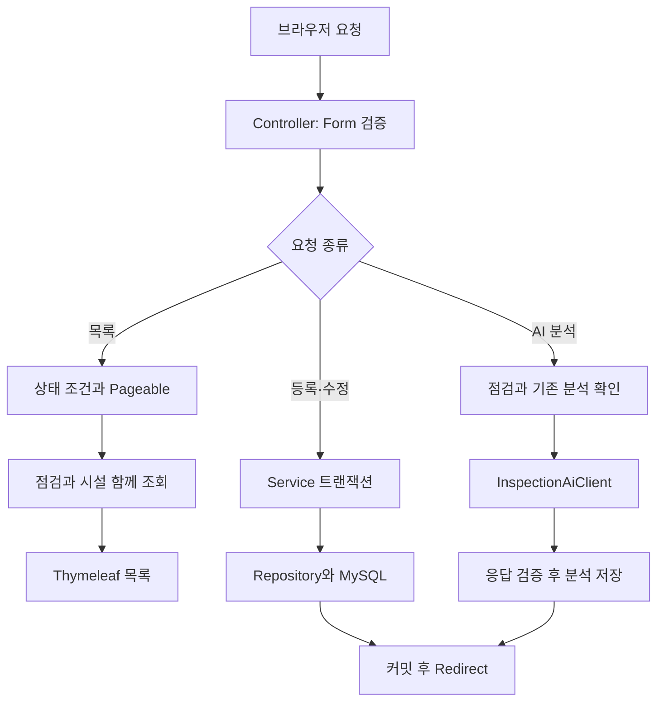
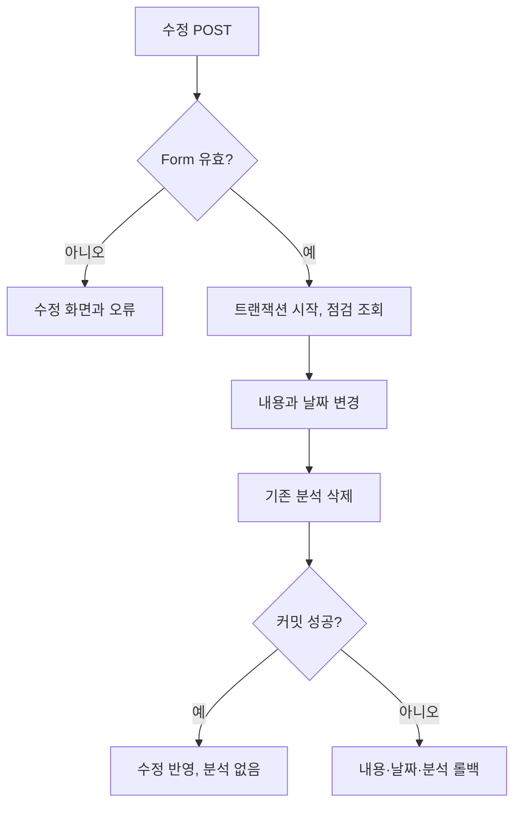

# WaterAPI 학습 인수인계

기준: 2026-11-18 데이터스피라 지원 준비. 이 문서를 다른 대화에 첨부하거나 저장소에서 읽도록 요청하면 이어서 학습할 수 있다. 다른 대화에 내용이 자동으로 전부 전달된다고 가정하지 않는다.

## 확정한 지원 방향

- 새 프로젝트를 만들지 않는다. WaterAPI를 대표, CloudGuard를 보조 포트폴리오로 사용한다.
- 소개: 외부 데이터 연동과 저장 규칙을 검증하고, 컨테이너 실행·복구까지 확인해 온 Java 백엔드 신입 개발자.
- 공통 태도: 데이터의 변경 기준을 정하고, 실제 처리 결과를 확인하려는 태도.
- CloudGuard: 기능 확장보다 예산 경계값 정확성. WaterAPI: 점검 목록의 시설명 조회 개선 한 가지, 수정/분석 삭제의 MySQL 검증, 주말 AWS 배포.
- 지원서에는 구현, 테스트 실행, 본인이 직접 재현한 경험을 구분한다. 모르는 내용을 경력처럼 쓰지 않는다.

## 사실과 한계

이전 main 기준: WaterAPI c0821b66fff221e9f9d862170e264f908cf69510, CloudGuard 9827750f922110b42c8c21bdbb2a5a010119d7a2.
이번 변경의 최종 테스트 결과와 원격 반영 상태는 `VERIFICATION_20261118.md`를 먼저 읽는다. 새 코드가 원격 main에 반영되었다고 추정하지 않는다.

2026-11-17 기록으로 확인한 범위: Windows Docker Compose/MySQL 8.4 실행, prod/stub 및 실제 OpenAI 분리, Flyway V1, 컨테이너 재생성 후 데이터 유지, 같은 MySQL 컨테이너 내 별도 DB 복원과 네 테이블 체크섬 일치, 스키마 변경 없는 이미지 교체/이전 이미지 복구.
AWS 배포는 아직 실행하지 않았다. 멀티테넌트, 인증/인가, 무중단 배포, 자동 롤백, 대규모 트래픽 처리 경험으로 확장해서 설명하지 않는다.

## 요청, 조회, 분석 흐름

기본 환경 H2 + Stub, 로컬 MySQL 개발 mysql + stub/openai, Docker/AWS 배포 prod + stub/openai다. Stub과 OpenAI를 동시에 활성화하지 않는다. 프로필로 DB 설정과 AI 구현체 선택을 구분한다.

## 수정 트랜잭션 흐름

업무 규칙: 같은 내용/날짜로 수정해도 기존 분석 삭제. 처리 상태는 유지. 분석 완료 여부는 분석 행 존재로 판단하며 PENDING/IN_PROGRESS/COMPLETED와 다르다. 점검 삭제는 분석 삭제 후 점검 삭제. 시설 삭제는 점검이 있으면 409.

## 내일부터의 학습 순서

| 차례 | 읽을 코드 | 설명할 수 있어야 하는 내용 |
| --- | --- | --- |
| 1 | InspectionReportController | GET/POST, Form, @Validated, BindingResult, Model, Redirect |
| 2 | InspectionReport, Facility | @ManyToOne, FK, 연관관계 주인, LAZY |
| 3 | InspectionReportService.updateInspection | @Transactional, 변경 감지, flush와 commit 차이 |
| 4 | InspectionMutationMySqlTest | 테스트에 @Transactional이 없는 이유, DB 오류와 롤백 |
| 5 | InspectionReportRepository | 시설명 접근과 N+1, EntityGraph, count 쿼리 |
| 6 | InspectionQueryMySqlTest | 같은 데이터/페이지/정렬, 캐시 초기화, SQL 수와 응답 시간 구분 |
| 7 | AiAnalysisService, InspectionAiClient | 인터페이스 의존과 프로필 Bean 선택 |
| 8 | OpenAiInspectionClient, OpenAiConfig | HTTP, JSON Schema, DTO, 400/502, 타임아웃 |
| 9 | V1 SQL, application-prod.properties | Flyway와 validate, 제약조건, 기존 DB 적용 주의 |
| 10 | Dockerfile, compose.yaml | 이미지/컨테이너/볼륨, env, health |
| 11 | 로컬실행검증.md | 데이터 유지/백업 복원/이미지 롤백의 차이 |
| 12 | deploy/compose.aws.yaml, AWS_WEEKEND.md | EC2/ECR/RDS/SSM, SG, TLS, 배포 완료 증거 |
| 13 | CloudGuard BudgetPolicy | BigDecimal, compareTo, 표시용 반올림과 판정 분리 |
| 14 | CloudGuard AwsCostImportServiceIntegrationTest | 순차 재수집, 출처 구분, manual 보존, flush/clear |

한 번에 개념 하나 → 해당 코드 10~20줄 → 사용자가 자기 말로 설명 → 짧은 확인 문제 순서로 진행한다. 이미 이해한 내용을 장황하게 반복하지 않는다. 람다/스트림보다 명시적인 코드 흐름으로 설명한다.

## 면접에서 정직하게 답할 경계

- “수정 시 분석 삭제”를 구현했어도 동시 분석 중 수정 경합까지 해결한 것은 아니다.
- 분석 UNIQUE 제약은 DB 중복 행을 막지만 동시에 두 번 외부 API를 호출하는 비용까지 막지 않는다.
- DB 트랜잭션 롤백은 외부 OpenAI 요청/과금을 되돌리지 않는다.
- EntityGraph는 페이지 조회의 시설 연관에 적용했다. 모든 N+1 문제나 대용량 플랫폼 성능을 해결했다고 표현하지 않는다.
- CloudGuard는 순차 재수집 기준이다. 동시 수집, 응답에서 사라진 서비스, 음수 크레딧 정책은 후속 과제다.
- AI 도움을 받은 코드는 실제로 실행하고 변경 이유를 설명할 수 있도록 학습한다. 테스트 수만 외우지 않는다.

## 다른 대화에서 붙여 넣을 문장

“포미트 프로젝트의 데이터스피라 지원 준비를 이어갈게. 첨부한 WaterAPI 학습 인수인계와 검증 결과를 먼저 읽어줘. WaterAPI가 대표, CloudGuard가 보조이고, 저장 규칙/수정과 분석 삭제/MySQL 검증/목록 조회 개선/주말 AWS 배포가 범위야. 완료와 미완료를 구분하고, 학습표 1번부터 내 코드로 한 개념씩 설명한 뒤 내가 설명할 수 있는지 확인해줘.”
